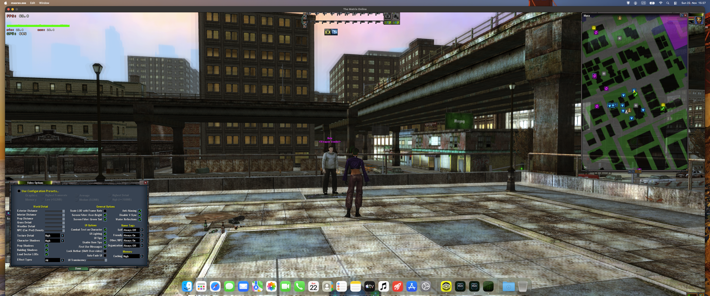

# The Matrix Online on Apple Silicon Macs

Makes The Matrix Online run fast in CrossOver on Apple Silicon Macs. It is for any project that
uses the 2009 client. It was tested with MxO Rejacked and MxO Revived.

On the test machine (M4, fullscreen 3440×1440, maximum detail) the game went from about 15 fps
with a shortened draw distance to 55–89 fps at full draw distance.



MxO Revived in the world at 63 fps, with the map and the video options open, in a window on a
3440×1440 screen.

## What you need

- An Apple Silicon Mac with macOS 26 or newer and [CrossOver](https://www.codeweavers.com/crossover)
  (tested with macOS 27 and CrossOver 26.3). The setup checks all three first.
- [Homebrew](https://brew.sh), for the build tools.
- The game itself, version 7.6005 (about 6 GB). The setup can download it from the MxOEmu
  project, or take your own copy.

## Set up

Close the game and its launcher and paste this into Terminal:

```sh
/bin/bash -c "$(curl -fsSL https://raw.githubusercontent.com/mxo-rebirth/mxo-apple-silicon/main/install.sh)"
```

It downloads this repository to `~/mxo-apple-silicon` and runs its setup. Running it again
updates the download. By hand, the same is: download this repository and run `scripts/setup.sh`
in it.


The setup checks the Mac, asks its few questions first (which bottle, which servers, a
frame-rate limit, add-ons, the build tools, maximum detail, the logo movies) and then works
through these steps by itself:

| Step | What it does |
|---|---|
| Game | Only when the bottle has no game yet. Creates the bottle if there is none. Gets the game itself: downloaded from the [MxOEmu project](https://mxoemu.info), or from a folder, an archive or a direct `https` link you give. Downloads the Rejacked launcher and the Revived installer from the projects' own sites, checks them against the checksums published there and opens them for you to click through, Microsoft's .NET 10 runtime first for Revived. Tells the Rejacked launcher where the game is. |
| Start fixes | Installs what the game needs to start at all: the game's own shader compiler, Microsoft's DirectMusic and DirectSound, the music sound bank, and a larger memory limit for the game. |
| Build | Builds the speed-up (`d3d9.dll`) on your Mac from your own copy of the game. Takes a few minutes. Installs the build tools with Homebrew first if they are missing and you agree. |
| Install | Installs it for every MxO game it found in the bottle, and lets the games share their pipeline caches so they stutter less. Everything else in the bottle keeps CrossOver's normal graphics. On request it also speeds up the routines that game add-ons hook. An add-on such as Revived's interface scaling can then stop working. |
| Detail | On request: every graphics option at its maximum (draw distance, shadows, wet streets, weather, traffic, anti-aliasing, screen filters), the resolution of the main display and 16x anisotropic filtering. It replaces the detail settings a game has, so the answer defaults to no once a game has settings. Later: `scripts/setup.sh detail`. |
| Intro | On request: the game starts without its logo movies. Later: `scripts/setup.sh intro`. |
| Icons | Only when CrossOver shows no icon for the Rejacked launcher: makes its shortcut again. Later: `scripts/setup.sh icons`. |
| Music | Revived only: keeps the game's music on. Revived's starter switches it off otherwise. In a bottle the setup has been through before, music that is off stays off. To switch it on: `scripts/setup.sh music`. |
| Launcher video | Revived only: switches off the video behind the launcher's window, which keeps a processor core busy. |

The first run downloads about 420 MB (Microsoft's DirectX packages, CodeWeavers' CrossOver
source code and a compiler) and uses about 1.1 GB of disk space in the `build` folder. The game
step adds the game (a 1.3 GB download, about 6 GB unpacked) and under 100 MB for the launchers
and the runtime.

Then start the game from its launcher as usual. If the Rejacked launcher still asks for the game
folder, choose `C:\Games\MxO` in its settings.

## Tips

- **Ctrl+Shift+F** in the game shows or hides the frame-rate counter. It starts hidden.
- **Fan noise:** the setup offers to limit the frame rate to 90 fps. Without a limit the game
  reaches up to 200 fps in light scenes, which only makes heat. For another limit run
  `~/mxo-apple-silicon/scripts/setup.sh --fps 120 install`. `--fps 0` removes it. A later run of
  the setup offers the limit the bottle has.
- **A second launcher later:** `~/mxo-apple-silicon/scripts/setup.sh game` offers the one that
  is not installed yet.
- **Another project's client:** if its game executable is not `matrix.exe` or `mxorev.exe`, add
  its name to the end of the command: `--exe name.exe`.
- **Rejacked:** untick "Use the new glow shader for 'Screen Filter: Over-Bright' (BETA)" in the
  launcher. It halves the frame rate at high resolutions.
- **Who is online:** <https://whoisjackedin.com> shows how busy the MxO servers are.
- **Close memory-hungry apps** before playing. When the Mac is short of memory, the game can
  stutter.

## Undo

```sh
~/mxo-apple-silicon/scripts/setup.sh uninstall
```

The game goes back to CrossOver's normal graphics. Every file the setup replaced was kept with
a `.setup-backup` suffix.

## Good to know

- **Use it at your own risk.** We take no responsibility for any damage. See the
  [licence](LICENSE).
- **Keep the game apart from your files.** Programs in CrossOver can reach every file of the
  macOS account they run in. Our advice: install and play under a separate, standard
  (non-admin) user account on your computer, with your main account behind its own password. A
  game client then cannot reach your everyday files and logins. The setup says so before it
  starts. In a separate account, first run
  `brew install mingw-w64 meson ninja glslang` in the account that has Homebrew.
- **Experimental.** It has been played by one person on one Mac, in short sessions.
- **Built on your Mac, from your game.** No game file is in this repository. Do not share the
  built `d3d9.dll`: it contains code translated from your game files.
- **It changes the game's code in memory** (math routines only, nothing network-related).
  Check that your server allows it.
- **Intel Macs and Windows PCs** gain nothing from the math part.

## More

For players:

| | |
|---|---|
| [docs/crossover.md](docs/crossover.md) | setting up the bottle and the game by hand |
| [docs/building.md](docs/building.md) | building and installing by hand, switches, going back |

For developers and the game teams:

| | |
|---|---|
| [docs/how-it-works.md](docs/how-it-works.md) | why the game is slow on Apple Silicon and what the fix is |
| [docs/client-notes.md](docs/client-notes.md) | reverse-engineering notes on the client |
| [docs/translator.md](docs/translator.md) | the x87 to SSE2 translator |
| [docs/graphics.md](docs/graphics.md) | the graphics problems and their fixes |
| [docs/measurements.md](docs/measurements.md) | method, results, open problems |
| [docs/development.md](docs/development.md) | repository layout, diagnostics, profiling |
| [tests/README.md](tests/README.md) | the tests that compare the translated math with the original |

## Licence

zlib: [LICENSE](LICENSE). The patch in `dxvk/` is a modified part of
[DXVK](https://github.com/doitsujin/dxvk), which has the same licence:
[dxvk/LICENSE](dxvk/LICENSE). This repository contains no game files, and the screenshot shows
the game.

The Matrix Online is a trademark of Warner Bros. Entertainment Inc. CrossOver is a trademark of
CodeWeavers, Inc. This fan project is not affiliated with or endorsed by Warner Bros.,
CodeWeavers or any of the server teams.
