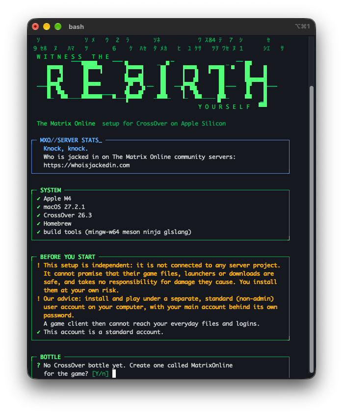

# The Matrix Online on Apple Silicon Macs

> [!WARNING]
> Experimental. Recommended for advanced users.

Makes The Matrix Online run fast in CrossOver on Apple Silicon Macs. It supports MxO Rejacked,
MxO Revived and MxOEmu.

It is the result of reverse engineering: taking the 2009 game apart without its source code.
The game does its math with an old kind of processor instruction, which Apple's chips can only
imitate slowly. This project translates 535 of the game's math routines into the modern kind
and swaps them in when the game starts. The results stay the same. It also fixes fifteen
graphics problems between the game and the Mac's graphics chip.
[How it works](docs/how-it-works.md)

On the test machine (M4) the game went from about 15 fps, with the game cutting its draw distance,
to 55–89 fps at full draw distance and maximum detail, fullscreen at 3440×1440.


MxO Revived at 63 fps, in a window on a 3440×1440 screen.

## What you need

- An Apple Silicon Mac with macOS 26 or newer
- [CrossOver](https://www.codeweavers.com/crossover)
- [Homebrew](https://brew.sh). Its installer also brings Apple's command line developer tools,
  which the setup needs
- Homebrew's build tools. In an administrator account the setup installs them for you. A
  standard account cannot install them: run this in an administrator account first:
  `brew install mingw-w64 meson ninja glslang`

The setup checks all of this before it changes anything, and says what is missing.

Tested on one Mac (M4) with macOS 27 and CrossOver 26.3. The setup can download the game itself.

## Set up

The command below downloads this repository and runs a script from it on your Mac. The script
changes files in the CrossOver bottle you choose and keeps a copy of every file it replaces.
Read [install.sh](install.sh) and [scripts/setup.sh](scripts/setup.sh) first if you want to
know what they do. You run it at your own risk.

Close the game and its launcher and paste this into Terminal:

```sh
/bin/bash -c "$(curl -fsSL https://raw.githubusercontent.com/mxo-rebirth/mxo-apple-silicon/main/install.sh)"
```

It clones this repository to `~/mxo-apple-silicon` and runs `scripts/setup.sh` there. Run it
again to update.

Step by step, from a Mac without CrossOver to the game:
[docs/quick-start.md](docs/quick-start.md).

Everything can also be done by hand, without the script:
[docs/crossover.md](docs/crossover.md) sets up the bottle and the game, and
[docs/building.md](docs/building.md#build) builds and installs the speed-up.



The setup asks a few questions and then does the rest:

| Step | What it does |
|---|---|
| Game | Gets the game and the launchers, if the bottle has none |
| Start fixes | What the game needs to start |
| Build | Builds the speed-up from your copy of the game |
| Install | Installs it for every MxO game in the bottle |
| Detail | On request: graphics settings for your Mac, lighter or maximum |
| Intro | On request: no logo movies |
| Revived | Music on. On request: launcher video off |
| Icons | Launcher icons in CrossOver |

The first run downloads about 420 MB and uses about 1.1 GB of disk space, Homebrew's build
tools not counted. The game adds a 1.3 GB
download, about 6 GB unpacked. Every step is described in [docs/building.md](docs/building.md).

Then start the game from its launcher as usual.

## Tips

- **Ctrl+Shift+F** in the game shows or hides the frame-rate counter.
- **Change something later:** run the same command again. It updates itself and asks its
  questions again, with what the bottle has as the defaults.
- **Another launcher later:** the same command with `game` at the end. If it adds a game,
  run the plain command once more afterwards: that sets the new game up.
- **Fan noise:** the setup offers a limit of 90 fps. For another one, put `--fps 120 install` at
  the end of the command.
- **Rejacked:** untick "Use the new glow shader for 'Screen Filter: Over-Bright' (BETA)" in the
  launcher. It halves the frame rate at high resolutions. If the launcher asks for the game
  folder, choose `C:\Games\MxO`.
- **Stutter:** close memory-hungry apps before playing.
- **Who is online:** <https://whoisjackedin.com>

## Undo

```sh
/bin/bash -c "$(curl -fsSL https://raw.githubusercontent.com/mxo-rebirth/mxo-apple-silicon/main/install.sh)" uninstall
```

The game goes back to CrossOver's normal graphics. What stays is listed in
[docs/building.md](docs/building.md#the-setup). Every file the setup replaced was kept with a
`.setup-backup` suffix.

## Good to know

- **Use it at your own risk.** See the [licence](LICENSE).
- **Our advice, not a requirement: play under a separate macOS account.** Programs in CrossOver
  can reach every file of the account they run in. In a standard account, the build tools have
  to be there first (see "What you need").
- **Built on your Mac, from your game.** No game file is in this repository. Do not share the
  built `d3d9.dll`.
- **It replaces some of the game's math code in memory** with faster code that gives the same
  results. Check that your server allows that.

## More

| | |
|---|---|
| [docs/quick-start.md](docs/quick-start.md) | step by step, without the details |
| [docs/crossover.md](docs/crossover.md) | setting up by hand |
| [docs/building.md](docs/building.md) | every setup step, building by hand, switches |
| [docs/how-it-works.md](docs/how-it-works.md) | why the game is slow on Apple Silicon and what the fix is |
| [docs/client-notes.md](docs/client-notes.md) | notes on the client |
| [docs/translator.md](docs/translator.md) | the x87 to SSE2 translator |
| [docs/graphics.md](docs/graphics.md) | the graphics problems and their fixes |
| [docs/measurements.md](docs/measurements.md) | method and results |
| [docs/development.md](docs/development.md) | layout, diagnostics, profiling |
| [tests/README.md](tests/README.md) | the tests |

## Licence

The code is zlib licensed, see [LICENSE](LICENSE). The patch in `dxvk/` is a modified part of
[DXVK](https://github.com/doitsujin/dxvk) (zlib), see [dxvk/LICENSE](dxvk/LICENSE). This
repository contains no game files, and the screenshot shows the game.

The Matrix Online is a trademark of Warner Bros. Entertainment Inc. CrossOver is a trademark of
CodeWeavers, Inc. This fan project is not affiliated with or endorsed by Warner Bros.,
CodeWeavers or any of the server teams.
